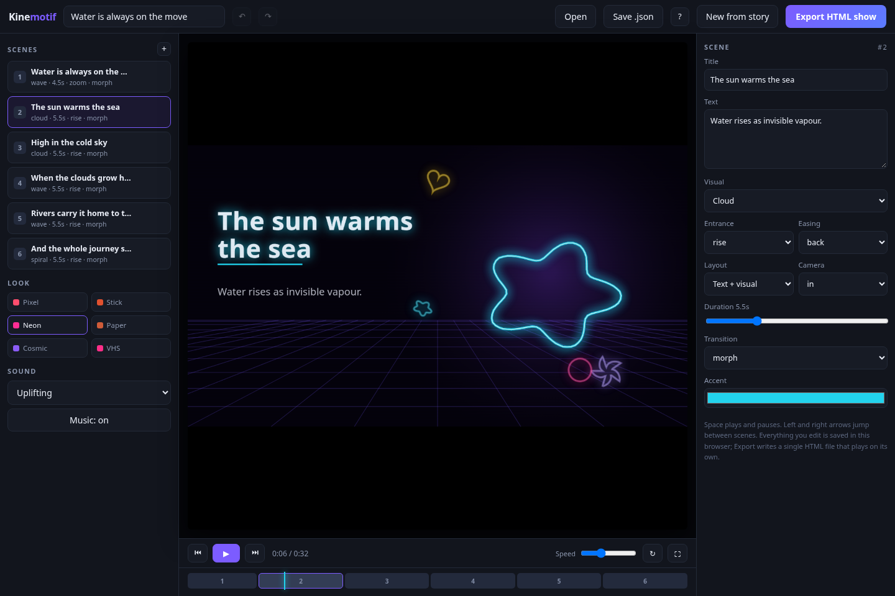
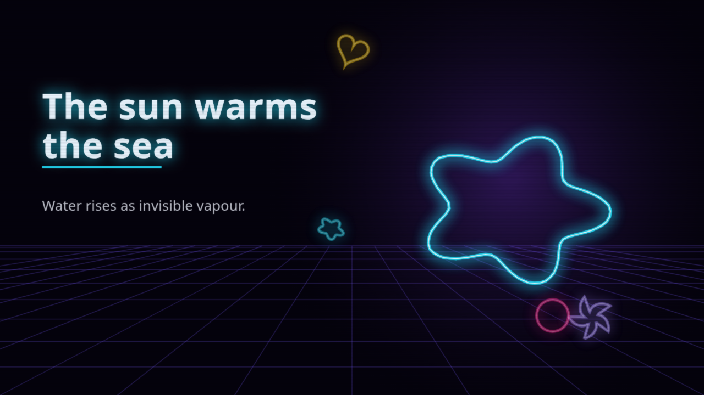

# Kinemotif

**Turn a paragraph into a moving, scored presentation — in one HTML file.**

Kinemotif is a self-contained HTML animation studio. You paste a story, choose an art style,
and it builds a multi-scene presentation that draws its own artwork, morphs between scenes,
and synthesises an original soundtrack while it plays. The finished show exports as a single
`.html` file that runs offline.

There are no images, fonts, audio files or dependencies in this repository. Every pixel is
drawn with Canvas 2D and every note is generated with the Web Audio API at runtime.



---

## Quick start

```bash
git clone https://github.com/drsamonline/kinemotif.git
cd kinemotif
open studio/kinemotif.html      # or just double-click it
```

No build step, no server, no install. Any current Chrome, Edge, Safari or Firefox will do.

1. Pick one of six looks.
2. Paste a paragraph — or tap a demo topic.
3. Press **Generate my show**.

Then edit anything you like, and press **Export HTML show** to get a standalone file.

---

## What it does

| | |
|---|---|
| **Six art styles** | Pixel Arcade, Stick Figure, Neon Night, Paper Cut, Cosmic Dream, VHS Retro. Each style carries its own palette, typography, background art, shape painting and post-processing. |
| **Real morphing** | Every motif is a closed polygon resampled to a common point count, so transitions interpolate actual geometry — a wave flows into a cloud into a rocket. |
| **Procedural score** | Seven moods (Uplifting, Calm, Epic, Playful, Tense, Lo-fi, Silent). Each has its own tempo, scale, chord progression, drum pattern and reverb tail, synthesised live. |
| **Story → storyboard** | Sentences become scenes; titles come from the first clause; pictures come from a keyword map over 14 motifs. Everything it produces is an editable form field. |
| **Motion controls** | Ten entrance presets, eight easing curves (including elastic, bounce and spring), three camera moves, seven transition types, per-scene duration. |
| **Export anything** | One-click standalone HTML show, project JSON, or reopen an exported show and keep editing. Undo/redo across all edits. |

---

## Examples

Four exported shows live in [`examples/`](examples/) — each is a single file, each has its own
soundtrack:

| Show | Style | File |
|---|---|---|
| The Water Cycle | Neon Night | [`examples/water-cycle.html`](examples/water-cycle.html) |
| A Seed Becomes a Tree | Paper Cut | [`examples/seed-to-tree.html`](examples/seed-to-tree.html) |
| Why We Ship Fast | Pixel Arcade | [`examples/ship-fast.html`](examples/ship-fast.html) |
| A Night in the City | VHS Retro | [`examples/night-city.html`](examples/night-city.html) |



---

## Documentation

- **[Guide](docs/guide.md)** — the wizard, the editor, every field, export and import.
- **[Reference](docs/reference.md)** — every style, motif, transition, entrance, easing, camera and mood.
- **[Project format](docs/project-format.md)** — the JSON schema and how an exported show works.

---

## How it works

```
┌──────────────┐   ┌──────────────┐   ┌──────────────┐   ┌──────────────┐
│  your text   │──▶│  story engine│──▶│ scene renderer│──▶│   export     │
│  (sentences) │   │ title · motif│   │ canvas + audio│   │ single .html │
└──────────────┘   └──────────────┘   └──────────────┘   └──────────────┘
```

The renderer keeps one offscreen buffer per style at that style's native resolution — 480×270
for Pixel Arcade, 1280×720 for Neon and Cosmic, full 1920×1080 for the rest — then blits it to
the display canvas with smoothing on or off depending on the style. That single decision is
what makes the pixel look genuinely pixelated and the neon look genuinely smooth.

Export works by serialising the live document, embedding the project JSON as
`window.__SHOW__`, and setting `window.__PLAY__ = 1`. On load, the same player boots into a
full-screen play-only mode. That is why an exported show is the same size as the studio: it
*is* the studio, holding a project.

---

## Keyboard shortcuts

| Key | Action |
|---|---|
| `Space` | Play / pause |
| `←` `→` | Previous / next scene |
| `Ctrl`/`Cmd` + `Z` | Undo |
| `Ctrl`/`Cmd` + `Shift` + `Z` | Redo |
| `E` | Export the HTML show |
| `?` | Shortcut panel |

---

## Limitations, stated plainly

- **The story engine is rule-based, not a language model.** It splits sentences, extracts
  titles and matches keywords to motifs. Concrete nouns ("rain", "climb", "team") produce
  better pictures than abstract ones. There is no API call and no key to configure.
- **It exports HTML, not MP4.** A show is a web page. If you need a video file, screen-record
  the full-screen playback, or add a `captureStream` + `MediaRecorder` step.
- **Audio needs one click.** Browsers block sound until the user interacts, so every show
  starts behind a play gate.
- **`prefers-reduced-motion` is respected** by not auto-playing the show. It does not remove
  motion from the animation itself.

---

## Credits and prior art

Built from scratch, but the design leans on ideas well established in the web-animation world:
the named-entrance catalogue popularised by Animate.css and Animista, the easing-curve
toolbox and JSON state export of visual keyframe editors, the undo/redo and project-file
conventions of timeline tools like Theatre.js and HTML5 Studio, and the "single self-contained
file" discipline of the whole genre.

## Licence

MIT — see [LICENSE](LICENSE).
